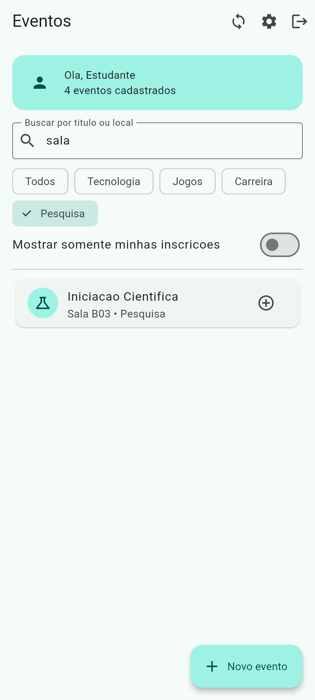
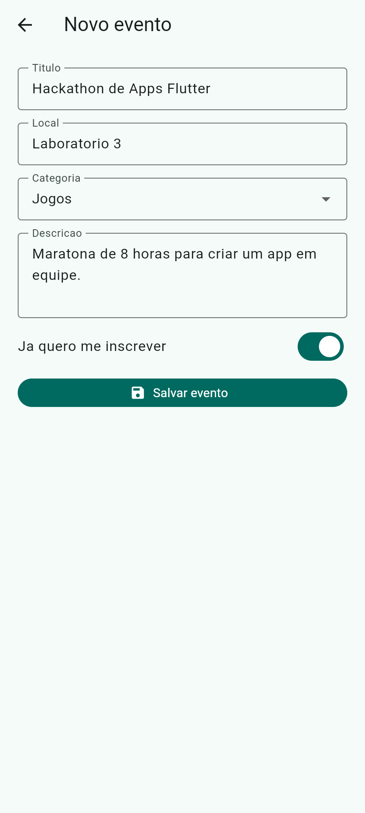
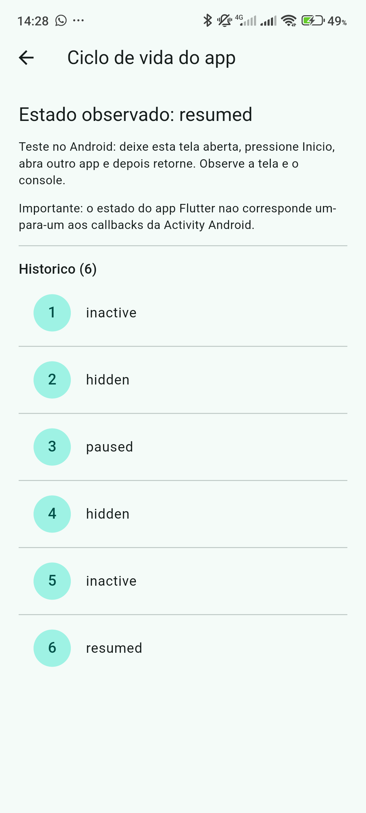

# Agenda de Eventos

Aplicativo Flutter de eventos acadêmicos, feito a partir do projeto base da atividade **N2 - E3** da disciplina de desenvolvimento mobile. O projeto base veio com 12 pontos incompletos, marcados como `TODO_ATIVIDADE_01` até `TODO_ATIVIDADE_12`. Todos foram completados, e os marcadores ficaram no código para facilitar a localização.

## O que foi implementado

| TODO | Arquivo | Implementação |
|---|---|---|
| 01 | `home_screen.dart` | Filtro combinado: busca por título ou local, categoria ("Todos" ou a selecionada) e "somente minhas inscrições", com `where().toList()` |
| 02 | `home_screen.dart` | `Navigator.push<bool>` para os detalhes; `true` remove o evento com `setState()` e mostra um SnackBar, e qualquer outro retorno atualiza a Home |
| 03 | `home_screen.dart` | `Navigator.push<Evento>` para o cadastro; o evento devolvido entra na lista com `setState()` e SnackBar |
| 04 | `home_screen.dart` | `AlertDialog` de confirmação e `pushAndRemoveUntil` para a `EntradaScreen`, limpando a pilha |
| 05 | `home_screen.dart` | `categorias.map(...)` gerando `FilterChip`, finalizado com `toList()` |
| 06 | `home_screen.dart` | Botão do `EventoCard` inverte `evento.inscrito` com `setState()` |
| 07 | `detalhes_evento_screen.dart` | `showDialog<bool>`: Cancelar fecha só o diálogo e Excluir faz `Navigator.pop(context, true)` |
| 08 | `detalhes_evento_screen.dart` | Botão alterna a inscrição com `setState()`, trocando entre "Inscrever-se" e "Cancelar inscricao" |
| 09 | `novo_evento_screen.dart` | Valida o `Form`, ativa `_salvando`, aguarda 600 ms, cria o `Evento` e devolve com `Navigator.pop(context, evento)` |
| 10 | `configuracoes_screen.dart` | Devolve `Map<String, bool>` com as chaves `notificacoes` e `modoCompacto` |
| 11 | `ciclo_vida_screen.dart` | `AppLifecycleListener` criado no `initState()`; o `onStateChange` atualiza o estado atual e o histórico, chama `debugPrint()` e `setState()` |
| 12 | `ciclo_vida_screen.dart` | `_listener?.dispose()` antes de `super.dispose()` |

## Como executar

```bash
flutter create --platforms=android .
flutter pub get
flutter run
```

A pasta `android/` já está no repositório, então o primeiro comando só é necessário se ela for apagada.

## Ciclo de vida no Android

Teste em um celular real: o app foi aberto na tela **Ciclo de vida**, posto em segundo plano com o botão Início e reaberto. Saída do console (`debugPrint`):

```
AppLifecycleState: inactive
AppLifecycleState: hidden
AppLifecycleState: paused
AppLifecycleState: hidden
AppLifecycleState: inactive
AppLifecycleState: resumed
```

Navegar entre telas Flutter (`push`/`pop`) não gera eventos: o app continua `resumed`, e o `State` da tela anterior segue montado na pilha. Só sair do app e voltar muda o ciclo de vida.

## Telas

| Lista com filtros | Detalhes | Cadastro | Ciclo de vida (Android) |
|---|---|---|---|
|  |  |  |  |

Todos os prints estão em [`docs/prints/`](docs/prints/).

## Estrutura

A estrutura de pastas do projeto base foi mantida (ver `ESTRUTURA.txt` e `GUIA_TODOS.md`). Não há pacotes além dos do projeto base.

Feito com Flutter 3.47 e Dart 3.13.
